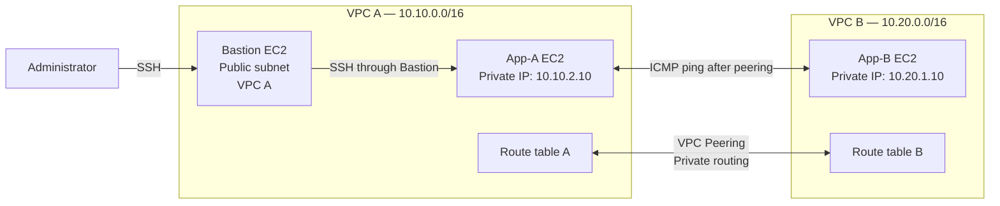

# AWS VPC Peering Lab — Private Connectivity Between Two VPCs

A hands-on AWS networking project that demonstrates how to connect two isolated Amazon Virtual Private Clouds (VPCs) using **VPC Peering**, route tables, security groups, EC2 instances, and AWS CloudFormation.

The project follows a before-and-after validation: communication between the application instances fails before peering, then succeeds after the peering connection and routes are configured.

> **Region used in the demonstrated lab:** `ap-southeast-2` (Asia Pacific — Sydney)  
> **Infrastructure deployment:** AWS CloudFormation  
> **EC2 instance type:** `t3.micro`

---

## Table of contents

- [Project overview](#project-overview)
- [Architecture](#architecture)
- [Network design](#network-design)
- [AWS resources](#aws-resources)
- [Prerequisites](#prerequisites)
- [Deployment walkthrough](#deployment-walkthrough)
- [Connect to the instances](#connect-to-the-instances)
- [Before-and-after connectivity evidence](#before-and-after-connectivity-evidence)
- [Troubleshooting](#troubleshooting)
- [Security and cost cleanup](#security-and-cost-cleanup)
- [What I learned](#what-i-learned)

## Project overview

The lab contains two VPCs with non-overlapping CIDR blocks:

- **VPC A:** `10.10.0.0/16`
- **VPC B:** `10.20.0.0/16`

Each VPC contains an application EC2 instance in a private subnet. A Bastion host in VPC A provides an SSH entry point to the private instance. Initially, the two application instances cannot communicate across the VPC boundary. The stack is then updated with `EnablePeering=true`, creating the VPC peering connection and the required routes.

The final test sends ICMP packets from App-A (`10.10.2.10`) to App-B (`10.20.1.10`).

## Architecture



**Traffic path for administration:** Administrator → Bastion public IP → App-A private IP.

**Application connectivity test:** App-A (`10.10.2.10`) → VPC Peering → App-B (`10.20.1.10`).

VPC peering is a private network connection between the two VPCs. It does not automatically configure routes or security-group rules; those must also permit the intended traffic.

## Network design

| Component | Demonstrated value |
|---|---|
| AWS Region | `ap-southeast-2` |
| VPC A CIDR | `10.10.0.0/16` |
| VPC B CIDR | `10.20.0.0/16` |
| Bastion private IP | `10.10.1.10` |
| App-A private IP | `10.10.2.10` |
| App-B private IP | `10.20.1.10` |
| Bastion public IP shown in lab | `3.107.76.200` |
| EC2 instance type | `t3.micro` |
| EC2 key pair | `aws-key-windows` |
| Initial peering setting | `EnablePeering=false` |
| Updated peering setting | `EnablePeering=true` |

The Bastion public IP is a value from the recorded lab session and may change if the instance is replaced. Do not hard-code it in scripts or documentation for a new deployment.

## AWS resources

The CloudFormation deployment created or managed resources for the two-VPC lab, including:

- Two VPCs.
- Public and private subnets.
- Internet gateway and its VPC attachment.
- Public and private route tables and route associations.
- EC2 instances for the Bastion host, App-A, and App-B.
- Security groups.
- A VPC peering connection and routes after the stack update.

The stack outputs recorded during the run included the private IP addresses, Bastion public/private IP addresses, VPC IDs, and a stage label.

## Prerequisites

Before starting, prepare:

1. An AWS account with permission to use CloudFormation, EC2, VPC, route tables, security groups, and key pairs.
2. An EC2 key pair available in `ap-southeast-2`.
3. The matching private key file (`.pem`) downloaded locally.
4. An SSH client on your computer.
5. Your current public IPv4 address in CIDR notation, normally `YOUR_PUBLIC_IP/32`, for restricting SSH access to the Bastion host.
6. The CloudFormation JSON or YAML template used for this lab.

**Important:** Never commit a `.pem` private key, AWS credentials, or other secrets to GitHub.

## Deployment walkthrough

### 1. Prepare the key pair and source IP

In the EC2 console, confirm that the key pair exists in the same AWS Region as the lab. The demonstrated key pair was `aws-key-windows`.

On macOS or Linux, restrict the private key file permissions:

```bash
chmod 400 ~/Downloads/aws-key-windows.pem
```

Find your current public IPv4 address and use it as `YOUR_PUBLIC_IP/32` in the template parameter. The screenshot evidence showed a public-IP lookup, but that address is not a permanent value.

### 2. Create the CloudFormation stack

In the AWS Console:

1. Open **CloudFormation → Stacks → Create stack**.
2. Choose **Choose an existing template**.
3. Select **Upload a template file** and upload the lab's YAML or JSON template.
4. Continue to **Specify stack details**.
5. Use a stack name such as `ewb-vpc-peering-lab`.
6. Set the parameters for the baseline deployment:

| Parameter | Baseline value |
|---|---|
| `EnablePeering` | `false` |
| `InstanceType` | `t3.micro` |
| `KeyName` | `aws-key-windows` |
| `MyPublicIp` | `YOUR_PUBLIC_IP/32` |

7. Keep the optional stack settings appropriate for your lab and review the configuration.
8. Create the stack and wait for **CREATE_COMPLETE**.

The initial baseline deployment intentionally uses `EnablePeering=false`, so the pre-peering connectivity test can be recorded.

### 3. Record the CloudFormation outputs

Open the stack's **Outputs** tab and record the values for:

- `BastionPublicIp`
- `BastionPrivateIp`
- `AppAPrivateIp`
- `AppBPrivateIp`
- `VpcAId`
- `VpcBId`
- `Stage`

The output names above describe the values visible in the lab; use the exact output keys defined by your own template. In the demonstrated deployment, the application private IPs were `10.10.2.10` and `10.20.1.10`, and the Bastion public IP was `3.107.76.200`.

### 4. Connect to the Bastion host

Replace the public IP and key path if your deployment returns different values:

```bash
ssh -i ~/Downloads/aws-key-windows.pem ec2-user@BASTION_PUBLIC_IP
```

For the recorded lab, the Bastion public IP was `3.107.76.200`:

```bash
ssh -i ~/Downloads/aws-key-windows.pem ec2-user@3.107.76.200
```

### 5. Connect from the Bastion host to App-A

From your local machine, use SSH ProxyCommand to reach App-A through the Bastion host. This avoids exposing App-A directly to the internet.

```bash
ssh -i ~/Downloads/aws-key-windows.pem \
  -o IdentitiesOnly=yes \
  -o "ProxyCommand=ssh -i ~/Downloads/aws-key-windows.pem -o IdentitiesOnly=yes -W %h:%p ec2-user@BASTION_PUBLIC_IP" \
  ec2-user@10.10.2.10
```

If your App-A private IP or Bastion public IP differs, substitute the values from CloudFormation outputs.

### 6. Verify the baseline before peering

Run this command **from App-A**:

```bash
ping -c 4 10.20.1.10
```

In the recorded baseline test, all four packets were lost. This was the expected result before VPC peering and cross-VPC routes were enabled.

### 7. Enable VPC peering by updating the stack

In **CloudFormation → your stack → Update stack**:

1. Choose the option to update the existing stack.
2. Use the same template unless you are intentionally changing it.
3. Set `EnablePeering` to `true`.
4. Keep the other parameter values consistent with the existing deployment.
5. Review and submit the update.
6. Wait for **UPDATE_COMPLETE**.

The successful update created the peering connection and the associated routes. Confirm that both VPC route tables contain routes to the other VPC's CIDR through the peering connection.

### 8. Test connectivity after peering

Reconnect to App-A if needed and run:

```bash
ping -c 4 10.20.1.10
```

The recorded test returned four replies, with **4 packets transmitted, 4 received, 0% packet loss**.

## Before-and-after connectivity evidence

The same test was run from App-A to App-B (`10.20.1.10`).

### Before peering — expected failure

```text
PING 10.20.1.10 (10.20.1.10) 56(84) bytes of data.

--- 10.20.1.10 ping statistics ---
4 packets transmitted, 0 received, 100% packet loss
```

**Interpretation:** The application instances did not have a working cross-VPC path before peering was enabled.

### After peering — successful private connectivity

```text
PING 10.20.1.10 (10.20.1.10) 56(84) bytes of data.
64 bytes from 10.20.1.10: icmp_seq=1 ttl=127 time=0.521 ms
64 bytes from 10.20.1.10: icmp_seq=2 ttl=127 time=0.167 ms
64 bytes from 10.20.1.10: icmp_seq=3 ttl=127 time=0.184 ms
64 bytes from 10.20.1.10: icmp_seq=4 ttl=127 time=0.168 ms

--- 10.20.1.10 ping statistics ---
4 packets transmitted, 4 received, 0% packet loss
```

<details>
<summary><strong>Result summary</strong></summary>

| Test stage | Packets sent | Packets received | Packet loss |
|---|---:|---:|---:|
| Before peering | 4 | 0 | 100% |
| After peering | 4 | 4 | 0% |

</details>

> **Evidence note:** These values are transcribed from the terminal screenshots captured during the lab. Add your original terminal screenshots to the repository (for example, under `docs/images/`) and embed them below if you want the README to show image evidence directly.

Suggested evidence layout:

```text
docs/
└── images/
    ├── cloudformation-create-complete.png
    ├── cloudformation-outputs.png
    ├── connectivity-before-peering.png
    ├── cloudformation-update-complete.png
    └── connectivity-after-peering.png
```

Then embed the images in this section:

```markdown


```

## Troubleshooting

| Symptom | Likely cause | What to check |
|---|---|---|
| CloudFormation reports `Invalid security group description` | The security-group description contains unsupported characters or is too long. | Use a concise description under 256 characters containing only characters allowed by EC2 security-group descriptions. |
| SSH returns `Permission denied (publickey)` | Wrong key, wrong login user, incorrect key permissions, or the Bastion host is not using the expected key pair. | Confirm the key pair attached to the instance, use `ec2-user` for Amazon Linux 2023, check the key path, and run `chmod 400` on the `.pem` file. |
| SSH to Bastion times out | Bastion is not reachable or SSH ingress is restricted incorrectly. | Check the Bastion public IP, instance state, subnet route to the internet gateway, security-group TCP/22 ingress, and your current public IP `/32`. |
| App-A cannot be reached through Bastion | ProxyCommand, key selection, username, or private IP is incorrect. | Verify the SSH command, key path, `ec2-user`, App-A private IP, and Bastion reachability. |
| Ping fails before peering | This is the expected baseline for this lab. | Record the result, then enable peering and configure both route tables. |
| Ping still fails after peering | A route, security-group rule, network ACL, or peering state may be incorrect. | Confirm the peering connection is active; check routes in both directions; allow the required ICMP traffic in the destination security group and network ACLs. |
| CloudFormation update is not complete | A resource operation may still be running or may have failed. | Review the stack **Events** tab and inspect the first resource-level failure before retrying. |

### Important networking checks

For App-A to reach App-B:

- The VPC CIDR blocks must not overlap.
- The peering connection must be active.
- VPC A's route table must route `10.20.0.0/16` to the peering connection.
- VPC B's route table must route `10.10.0.0/16` to the peering connection.
- App-B's security group and network ACLs must allow the intended ICMP traffic.
- Return traffic must be permitted.

A successful peering connection alone does not guarantee application connectivity.

## Security and cost cleanup

- Restrict SSH ingress to your own public IP using `/32`; do not use `0.0.0.0/0` for SSH.
- Keep App-A and App-B in private subnets and administer them through the Bastion host.
- Never upload the `.pem` file or AWS credentials to GitHub.
- Do not publish live public IPs, account IDs, access keys, or other sensitive environment details unnecessarily.
- EC2 instances and related resources can continue generating charges while running.
- When finished collecting evidence, delete the CloudFormation stack and verify that its resources have been removed. Check for any separately created resources that are not managed by the stack.

## What I learned

Through this project, I practised:

- Designing non-overlapping VPC CIDR ranges.
- Deploying repeatable AWS infrastructure with CloudFormation.
- Working with public and private subnets, route tables, and internet gateways.
- Using a Bastion host and SSH ProxyCommand for private-instance access.
- Establishing VPC peering and configuring routes in both VPCs.
- Diagnosing connectivity with ICMP ping and CloudFormation Events.
- Comparing baseline and post-change results to validate a network configuration.

---

**Project status:** Successfully deployed and updated in the recorded lab; post-peering connectivity test passed with 0% packet loss.

**Author:** Add your name and GitHub profile here.
